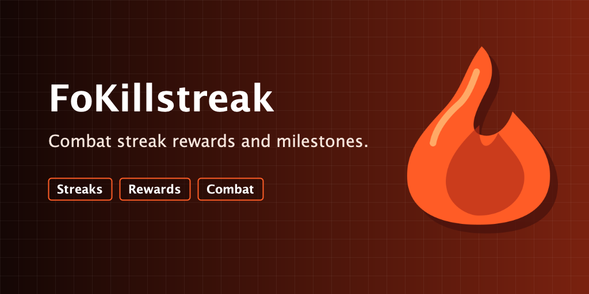
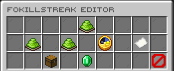
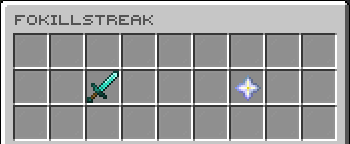
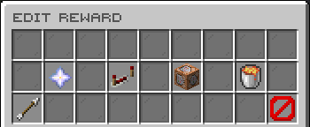
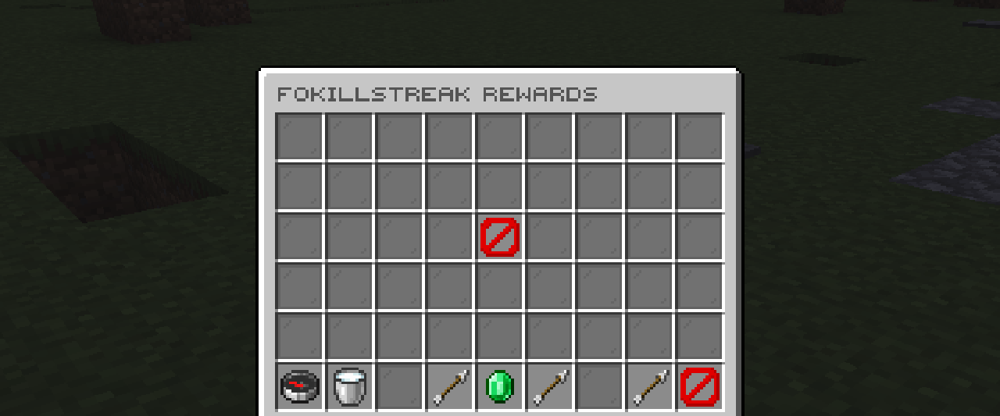

# FoKillstreak

[](https://modrinth.com/plugin/fokillstreak) [](https://modrinth.com/plugin/fokillstreak/versions) [](https://discord.gg/kEF77QCfu7)

Persistent PvP killstreaks with rewards, leaderboards, and anti-farming controls.

*Developed by Carrotio.*

## Features

- Tracks current and best PvP killstreaks persistently.
- Provides a player leaderboard and administrator editor.
- Runs configurable milestone rewards and broadcasts.
- Includes same-victim cooldown protection against farming.
- Exposes killstreak, best-streak, and rank placeholders.

## Download and dependencies

Download the latest compatible version from [Modrinth](https://modrinth.com/plugin/fokillstreak). Check the [versions page](https://modrinth.com/plugin/fokillstreak/versions) for supported Minecraft versions and server platforms.

- **Required:** None
- **Optional integrations:** `PlaceholderAPI`

## Screenshots



*Configure FoKillstreak.*



*View the player leaderboard.*



*Edit a milestone reward.*



*Browse configured rewards.*

## Support

For help or issue reports, join the [Carrotio Discord server](https://discord.gg/kEF77QCfu7).

<details>
<summary><strong>Commands and permissions</strong></summary>

### Commands

- `/fokillstreakadmin <version|reload|editor|set>` — Manage FoKillstreak. Aliases: `/killstreakadmin`, `/ksadmin`.
- `/killstreak` — Open the FoKillstreak leaderboard. Aliases: `/ks`.

### Permissions

- `fokillstreak.admin` — Allows access to FoKillstreak admin tools. Default: `op`.
- `fokillstreak.use` — Allows players to open the FoKillstreak leaderboard. Default: `true`.

</details>

<details>
<summary><strong>PlaceholderAPI</strong></summary>

Requires PlaceholderAPI.

- `%fokillstreak_killstreak% / %fokillstreak_killstreak_raw%` — Current killstreak.
- `%fokillstreak_best% / %fokillstreak_best_raw%` — Best recorded killstreak.
- `%fokillstreak_rank%` — Current-streak leaderboard rank.

</details>

<details>
<summary><strong>Configuration</strong></summary>

- `config.yml` — Main behavior and feature settings.
- `messages.yml` — Player-facing messages and interface text.
- `sounds.yml` — Configurable interaction sounds.
- `guis/*.yml` — GUI layouts, slots, labels, and lore.

Main config areas: `death-reset`, `same-victim-cooldown`, `native-dialogs`, `broadcasts`, `rewards`.

</details>

<details>
<summary><strong>Developer API</strong></summary>

FoKillstreak exposes `me.foesio.foKillstreak.api.KillstreakService` through Bukkit's
`ServicesManager` after its database opens. It unregisters the service on disable.
Compile against the **FoKillstreak jar** as a provided dependency; do not shade it
into the consumer. The coordinates below describe this local project, not a
published Maven repository. Install the matching jar in your local Maven repository
if needed:

```sh
mvn install:install-file -Dfile=/path/to/FoKillstreak-2.1.jar -DgroupId=me.foesio -DartifactId=FoKillstreak -Dversion=2.1 -Dpackaging=jar
```

```xml
<dependency>
  <groupId>me.foesio</groupId>
  <artifactId>FoKillstreak</artifactId>
  <version>2.1</version>
  <scope>provided</scope>
</dependency>
```

For a `plugin.yml` consumer, add `softdepend: [FoKillstreak]` (or `depend` when
required). For an optional integration, check that FoKillstreak is enabled
**before loading a separate class** that references its API types:

```java
if (Bukkit.getPluginManager().isPluginEnabled("FoKillstreak")) {
    new FoKillstreakBridge().showStreak(player);
}
```

Inside `FoKillstreakBridge`:

```java
var registration = Bukkit.getServicesManager().getRegistration(KillstreakService.class);
if (registration != null) {
    KillstreakService streaks = registration.getProvider();
    streaks.getStreak(player.getUniqueId()).ifPresent(snapshot ->
            player.sendMessage("Current: " + snapshot.current()));
}
```

`getStreak(UUID)` returns an immutable stored snapshot or empty for an unknown
UUID. `best` is the stored best field; an admin may set it below `current`.
`getTop(type, limit)` returns positive entries with one-based ranks, and
`getRank(UUID, type)` returns `-1` when unranked. Leaderboard results may lag a
write by up to one second. Invalid or disabled-service queries return empty
results or `-1`.

`setStreak(UUID, name, type, value)` sets one field; `resetCurrent(UUID, name)`
sets current to zero. Both work for offline UUIDs, reject negative values and
blank names, and return `ChangeResult` (`CHANGED`, `UNCHANGED`, `INVALID`,
`SAVE_FAILED`, or `UNAVAILABLE`). They do not run kill rewards or broadcasts.
`creditKill(Player killer, Player victim)` credits an online killer once, checks
same-victim cooldown, fires `KillCreditPreEvent`, saves the new streak, then
runs rewards and milestone broadcasts. It returns `CreditResult` (including
`IN_PROGRESS` for a concurrent or recursive request for the same pair and
`CAPACITY_REACHED` when the cooldown tracker is full). It does not
reset the victim; custom elimination plugins must handle that separately and
avoid also crediting the same normal `PlayerDeathEvent`.

`KillCreditPreEvent` is cancellable and fires after the initial cooldown check.
Cancellation prevents killer credit, cooldown recording, rewards, and milestone
broadcasts; it does not undo a victim death reset. A later cooldown capacity
or save failure can also stop credit. `KillstreakChangeEvent` is
not cancellable. It reports immutable previous/current snapshots and cause
`KILL`, `DEATH`, `ADMIN`, or `API` after a successful SQLite save, only when a
stored streak value changes. Its other-player UUID is the victim for `KILL`,
the killer for `DEATH`, and otherwise null. On a normal PvP death, the victim's
reset event precedes the killer's pre-credit and change events; rewards and
milestone broadcasts follow the killer's change event. Database loading,
blocked kills, failed saves, and no-op writes fire no change event.

```java
@EventHandler
public void onStreakChange(KillstreakChangeEvent event) {
    if (event.getCause() == ChangeCause.DEATH && event.getPrevious() != null) {
        int lost = event.getPrevious().current();
        // React to this player's ended streak.
    }
}
```

Calls and events run in the caller's execution context without a scheduler
hop. Call player actions on the server context that owns those players; event
handlers must not assume every dispatch runs on the global primary thread,
especially on regionized servers. Reacquire the service after a provider
disable and later enable rather than caching a stale instance.

</details>
